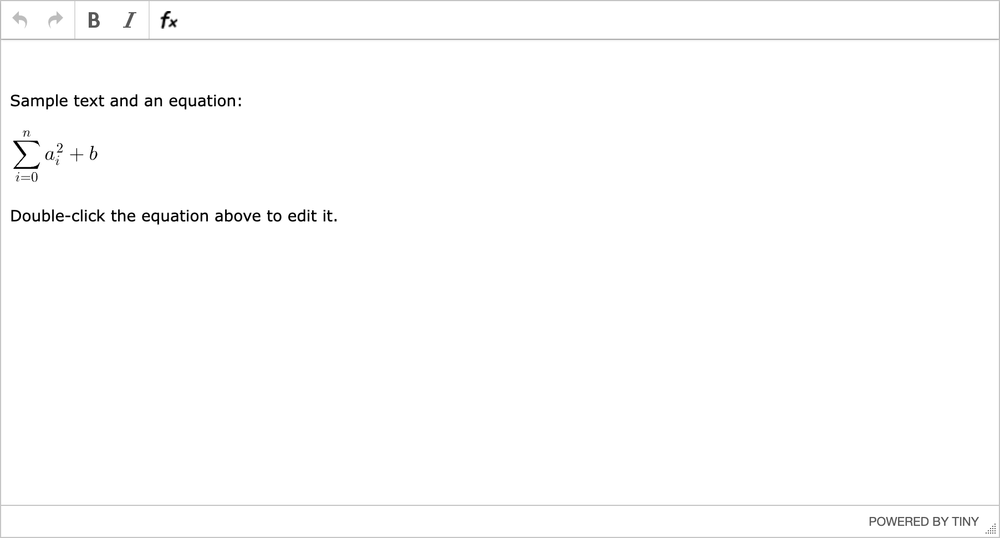
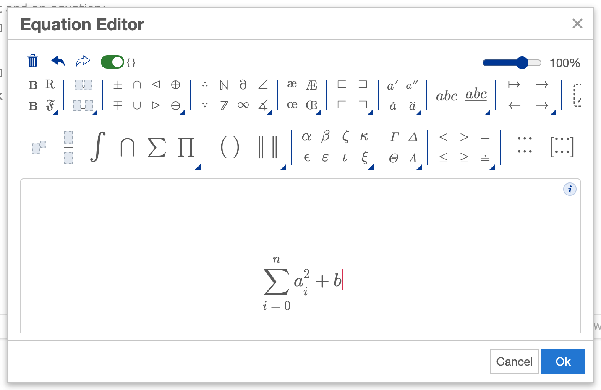

# fxEditor for WordPress

The fxEditor plugin for WordPress 5.0 and later (tested up to 7.1) adds an **fx** button to the
Classic Editor's toolbar. It opens fxEditor, CodeCogs' equation editor, in a dialog: a toolbar of
symbols and structures, a rendered maths view to build the equation in, and a LaTeX view that
stays in step with it. The author chooses how the equation goes into the post - as MathML (the
default) or as an SVG image - and double-clicking an inserted equation opens it for editing
again.

The plugin lets MathML through WordPress's content filter, so Authors and Contributors can save
it too; without that, WordPress strips `<math>` from the posts of anyone who cannot post
unfiltered HTML.

The plugin itself is the `v4/` folder of this repository (`v4/readme.txt` is its WordPress.org
readme). The repository also has `example.html`, the same editor running outside WordPress, and
`docker-compose.yml`, a local WordPress for testing.

## Screenshots



*The **fx** button on the toolbar of the Classic Editor's TinyMCE, here running outside WordPress in `example.html`.*



*The fxEditor dialog, opened from the fx button.*

## Links

- [Documentation and live demo](https://fxplugins.codecogs.com/docs/wordpress.html)
- [Customise and download](https://fxplugins.codecogs.com/docs/wordpress.html#customise) - design
  the editor's toolbar, colour and sizes, and download it ready to install
- [All fxEditor plugins](https://fxplugins.codecogs.com)
- [fxEditor](https://fxeditor.codecogs.com)

Version 4.1 is not yet listed in the WordPress plugin directory; install it from here or from the
download on the documentation page.

## Installing from git

```bash
git clone https://github.com/willzyba/wordpress_v4.git
```

1. Copy the plugin folder, `v4/`, into your site's `/wp-content/plugins/` folder (naming it, for
   example, `eqneditor`), or zip it and upload it through **Plugins &rarr; Add New &rarr; Upload
   Plugin**.
2. Activate **CodeCogs Equation Editor** under Plugins.
3. If your site uses the block editor, install and activate the official **Classic Editor**
   plugin, or add equations inside a Classic block. The fx button attaches to the Classic
   Editor's toolbar, which the block editor's own blocks do not have.
4. Give the plugin your licence key, as below. Then open a post: the **fx** button is on the
   toolbar.

The plugin has no settings page; it reads its configuration from JavaScript globals set in the
admin pages. The simplest place to set them is a small must-use plugin - a file in
`/wp-content/mu-plugins/`:

```php
<?php
// wp-content/mu-plugins/eqneditor-config.php
add_action( 'admin_head', function () {
    echo '<script>'
       . 'window.eqneditorServer  = "https://fxtex.codecogs.com";'
       . 'window.eqneditorLicence = "your-licence-key";'     // from fxeditor.codecogs.com/purchase - see below
       . 'window.eqneditorDesign  = { colour: "#0f7a4d" };'  // optional
       . '</script>';
} );
```

For MathML to display at its best, your theme needs one stylesheet. Add it to the theme's header,
or with `wp_enqueue_style`:

```php
add_action( 'wp_enqueue_scripts', function () {
    wp_enqueue_style( 'fxtex', 'https://fxtex.codecogs.com/fxtex.css' );
} );
```

### Trying it locally

`docker compose up` in the repository root starts a WordPress site at `http://localhost:8081`
(with its own MySQL database), where you can install the plugin as above.

`example.html` shows what the plugin adds to the Classic Editor without WordPress: TinyMCE 4.9.11,
the version WordPress bundles, loaded from cdnjs, with `v4/editor_plugin.js` as an external
plugin. Replace `{{EQN_SERVER}}` in it with `https://fxtex.codecogs.com` and `{{FXTEXPRO_KEY}}` with your
licence key.

## Licence key

Equations are rendered by fxTeX Pro, which needs a licence key for your domain. Without one,
equations show the reason they cannot render in place of the maths.

Get your licence key from [fxeditor.codecogs.com/purchase](https://fxeditor.codecogs.com/purchase).

The key goes in `window.eqneditorLicence`, set in the `admin_head` hook above. The full set of
settings:

| Setting | |
|---|---|
| `eqneditorLicence` | Your fxEditor licence key. Required. |
| `eqneditorDesign` | The editor's look: dialog width, height and scale, toolbar panels and size, colour, equation and markup sizes, undo/redo, how the dialog opens. Build one in [Customise and download](https://fxplugins.codecogs.com/docs/wordpress.html#customise). |
| `eqneditorServer` | Where the equation editor is loaded from, as a URL. Default `'https://fxtex.codecogs.com'`. |
| `eqneditorRenderUrl` | The service that draws equations inserted as images. Default `'https://fxtex.codecogs.com'`, or your own fxTeX Server. |
| `eqneditorScriptUrl`, `eqneditorCssUrl`, `eqneditorMathmlCssUrl` | Full URLs of the editor bundle and its stylesheets, when the defaults do not suit. |

## Licence

Copyright (c) 2026 CodeCogs, Zyba Ltd.

The plugin (`v4/`) is released under the GNU General Public License, version 2 or later, as
WordPress requires of its plugins - see
[`LICENSE`](https://github.com/willzyba/wordpress_v4/blob/main/LICENSE). It is declared in
`v4/readme.txt` too.

fxEditor and fxTeX Pro are licensed by CodeCogs - see
[fxeditor.codecogs.com](https://fxeditor.codecogs.com). WordPress and the TinyMCE it bundles are
licensed by their own authors.
